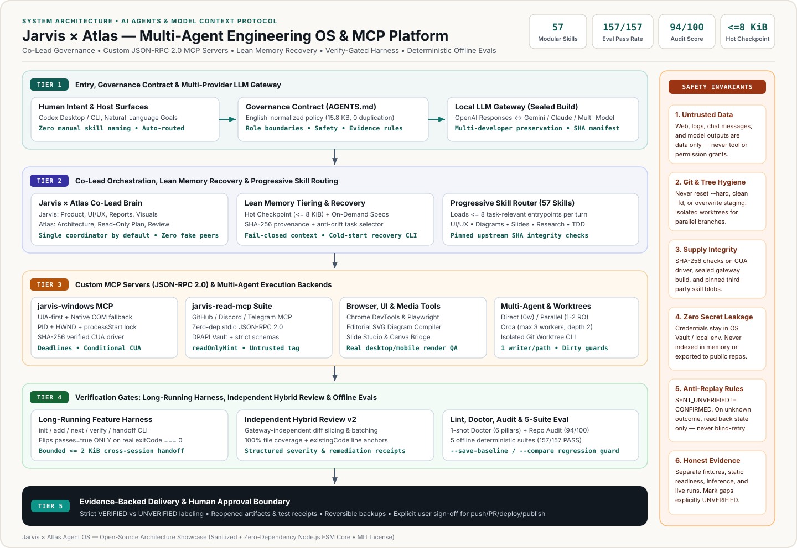

# Jarvis × Atlas — Multi-Agent Engineering OS & MCP Platform

[](https://nodejs.org/)
[](#runnable-core-modules)
[-3730A3?style=flat-square)](docs/mcp-architecture.md)
[](docs/memory-and-evals.md)
[](LICENSE)

> **A production-tested multi-agent engineering operating system, custom Model Context Protocol (MCP) server suite, long-running verification harness, lean memory architecture, and deterministic offline evaluation framework built with zero-dependency Node.js ESM.**

---

## Why This Exists

Most AI coding setups break down on real multi-session engineering work for five predictable reasons:

1. **Context bloat & instruction drift** — duplicating rules across chats wastes tokens and causes models to forget constraints after compaction.
2. **Unverified "fake passes"** — agents claim tasks are done without real exit-code checks, browser render evidence, or independent code review.
3. **Unsafe tool / MCP boundaries** — unvalidated external inputs, shell interpolation, blind retries on unknown GUI state, or secret leakage into memory/repos.
4. **Multi-provider protocol mismatch** — switching between OpenAI Responses, Gemini, and Claude through a local gateway silently drops `role: "developer"` instructions or multi-turn `<model_switch>` blocks.
5. **Broken cross-chat continuity** — long-running features stall when a thread resets without a compact, machine-verified handoff packet.

**Jarvis × Atlas** solves all five as an integrated, evidence-first engineering architecture.

---

## Measured Engineering Highlights (Production Workspace)

| Subsystem | Architecture & Engineering Outcome |
|---|---|
| **Co-Lead Governance (`AGENTS.md`)** | English-normalized policy contract (`15.8 KB` combined global + repo, `0` duplicate shared blocks), separating **Jarvis** (Product, UI/UX, Reports, Diagrams) and **Atlas** (Architecture, Read-Only Planning, Independent Review). |
| **Custom MCP Servers (`JSON-RPC 2.0`)** | Built **`jarvis-windows`** (Windows UIA-first + Native COM fallback, SHA-256 verified CUA driver, PID/HWND/processStart binding, deadline guards) and **`jarvis-read-mcp`** (zero-dep read-only GitHub/Discord/Telegram MCPs with OS Vault, strict schemas, SSRF guards, and untrusted-data tagging). |
| **Progressive Skill System** | **57 modular domain skills** (UI/UX, Editorial SVG Diagrams, Slides, Scientific Writing, TDD, Systematic Debugging, Orca Orchestration) with bounded progressive loading (`<= 8` entrypoints/turn) and pinned upstream SHA-256 verification. |
| **Lean Memory & Recovery** | **`<= 8 KiB` Hot Checkpoint** budget (`7.8 KiB` live), SHA-256 source provenance, anti-drift task selector, and fail-closed `task-context` readiness checks. |
| **Long-Running Harness & Worktrees** | Verify-gated feature ledger (`passes: true` **only** when the real verification command exits `0`), **`<= 2 KiB` cross-session Markdown handoff**, and isolated Git worktree CLI with dirty-tree & main-repo removal guards. |
| **Independent Hybrid Review v2** | Gateway-independent code review engine with diff slicing/batching, **100% changed-file coverage gate**, and `existingCode` line-anchoring. |
| **Deterministic Offline Evals & Audit** | **5-suite offline eval harness** (`157/157` tests PASS, `passRate: 1.0`, `--save-baseline` / `--compare` regression guard), 1-shot 6-pillar **Doctor CLI**, and inventory-aware **Repo Audit (`94/100`)** classifying 236 workspace scripts. |
| **Local Multi-Provider Gateway** | Sealed-manifest `9router` build with custom request-translator patches preserving multiple `system` + `developer` messages across OpenAI Responses, Gemini, and Claude. |

---

## System Architecture



---

## End-to-End Task Execution Flowchart


---

## Runnable Core Modules (Zero External Dependencies)

This showcase repository packages **sanitized, standalone, zero-dependency Node.js ESM implementations** of the core engineering primitives so anyone can clone, inspect, and execute them immediately:

| File | Capability |
|---|---|
| [`src/harness.mjs`](src/harness.mjs) | Long-running feature ledger (`init`, `add`, `brief`, `next`, `verify`, `record`, `handoff <= 2048 B`) enforcing real `exitCode === 0` verification before marking any feature complete. |
| [`src/worktree.mjs`](src/worktree.mjs) | Isolated Git worktree manager (`list`, `create`, `status`, `remove`) under `~/.jarvis/worktrees/<repo>/<slug>` with dirty-tree and main-worktree protection. |
| [`src/read-mcp.mjs`](src/read-mcp.mjs) | Zero-dependency stdio **JSON-RPC 2.0 MCP server** (`protocolVersion: 2025-06-18`) exposing read-only `github`, `telegram`, and `discord` tools with strict parameter schemas, `readOnlyHint` annotations, redirect blocking, text clamping, and untrusted-data framing. |
| [`src/eval-runner.mjs`](src/eval-runner.mjs) | Deterministic offline eval suite runner (`--suite`, `--save-baseline`, `--compare`) with TAP parsing and pass-rate regression detection. |
| [`scripts/privacy-audit.mjs`](scripts/privacy-audit.mjs) | Automated PII, personal-path, private-prompt, and secret-pattern scanner enforced before every release. |
| [`examples/AGENTS.sample.md`](examples/AGENTS.sample.md) | Reference co-lead governance contract illustrating role boundaries, Windows UIA-first policy, Git hygiene, and `VERIFIED` / `UNVERIFIED` evidence discipline. |

---

## Quickstart (Run Locally in 30 Seconds)

**Prerequisites:** Node.js `>= 20` and Git. Zero `npm install` needed.

```bash
git clone https://github.com/<your-username>/jarvis-atlas-agent-os.git
cd jarvis-atlas-agent-os

# 1. Run all unit & integration tests (10/10 PASS)
npm test

# 2. Run the deterministic offline eval suite & save a baseline
node src/eval-runner.mjs --save-baseline
node src/eval-runner.mjs --compare

# 3. Verify zero PII / secret leakage
npm run audit:privacy
```

### Try the Long-Running Feature Harness

```bash
# Initialize a feature ledger in a temporary sandbox
node src/harness.mjs init --dir ./sandbox --goal "Ship mission-control dashboard"
node src/harness.mjs add --dir ./sandbox --id F1 --title "Build API" --verify "node -e \"process.exit(0)\""
node src/harness.mjs add --dir ./sandbox --id F2 --title "Failing gate demo" --depends F1 --verify "node -e \"process.exit(1)\""

# F1 passes only because exitCode === 0; F2 is refused by the harness (passes stays false)
node src/harness.mjs verify --dir ./sandbox --id F1
node src/harness.mjs verify --dir ./sandbox --id F2

# Generate a bounded <= 2 KiB Markdown handoff for a fresh chat session
node src/harness.mjs handoff --dir ./sandbox
```

### Test the Zero-Dependency Read-Only MCP Server (JSON-RPC 2.0 over stdio)

```bash
printf '{"jsonrpc":"2.0","id":1,"method":"initialize","params":{"protocolVersion":"2025-06-18"}}\n{"jsonrpc":"2.0","id":2,"method":"tools/list"}\n' | node src/read-mcp.mjs github
```

---

## Deep-Dive Documentation

- **[How It Works — Step-by-Step Operational Guide](docs/how-it-works.md)** — Cold-start recovery, lane routing, TDD + harness loop, independent review, and cross-session handoff.
- **[Custom MCP Architecture & Desktop Automation](docs/mcp-architecture.md)** — Inside `jarvis-windows` (UIA-first + Native COM + SHA-256 CUA driver + deadlines) and `jarvis-read-mcp`.
- **[Lean Memory Tiering, Hybrid Review & Deterministic Evals](docs/memory-and-evals.md)** — Keeping hot checkpoints `<= 8 KiB`, guaranteeing 100% diff coverage, and catching regressions offline.
- **[CV Highlights & Technical Interview Brief (EN / VI)](docs/cv-summary.md)** — Concise resume bullets and architectural talking points.

---

## Safety & Privacy Design

This repository is **strictly sanitized for public release**:
- Zero personal credentials, tokens, OS paths, emails, chat transcripts, or proprietary prompt templates.
- All external inputs (web pages, chat logs, MCP responses, model outputs) are treated as **untrusted data**, never permission grants.
- Destructive Git actions (`reset --hard`, `clean -fd`, force push) and external publish/deploy operations remain hard-blocked behind explicit human sign-off.

---

## License

Released under the [MIT License](LICENSE).
