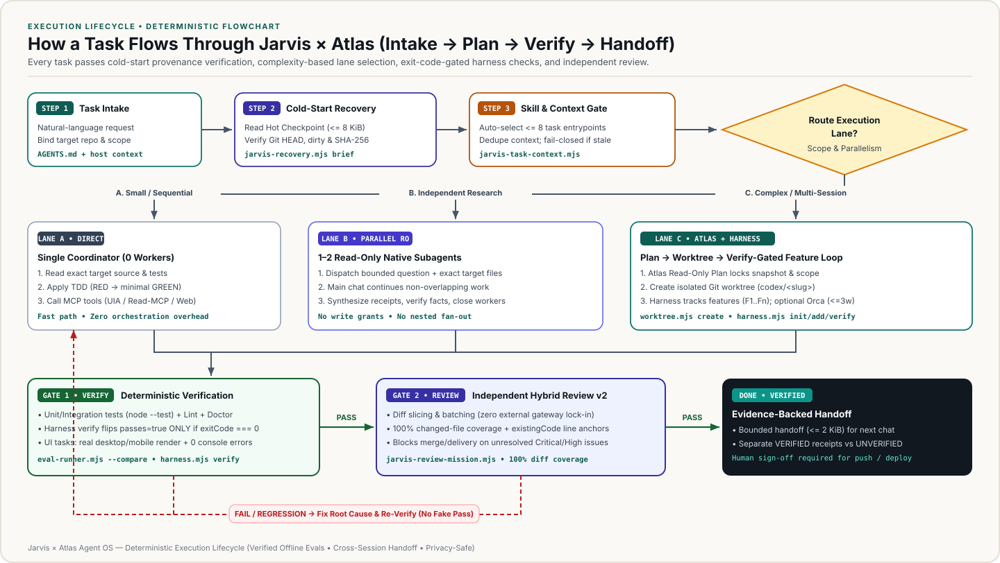

# Jarvis × Atlas Agents — Multi-Agent Engineering OS & MCP Platform

[](https://nodejs.org/)
[](#runnable-source-architecture-src)
[-3730A3?style=flat-square)](docs/mcp-architecture.md)
[](docs/skills-catalog.md)
[](docs/memory-and-evals.md)
[](LICENSE)

> **A complete, clone-and-run Multi-Agent Engineering Operating System, custom Model Context Protocol (MCP) server suite, progressive 57-skill routing framework, verify-gated long-running harness, lean memory recovery controller, independent hybrid code review engine, and deterministic offline eval runner—implemented in zero-dependency Node.js ESM.**

---

## Table of Contents

1. [Why Jarvis × Atlas Exists](#why-jarvis--atlas-exists)
2. [System Architecture & Execution Flowcharts](#system-architecture--execution-flowcharts)
3. [Repository Structure (Full Downloadable Source)](#repository-structure-full-downloadable-source)
4. [Quickstart & Bootstrap Into Your Own Repo](#quickstart--bootstrap-into-your-own-repo)
5. [Unified CLI Reference (`jarvis`)](#unified-cli-reference-jarvis)
6. [Progressive Skills System (How It Works & Full Catalog)](#progressive-skills-system-how-it-works--full-catalog)
7. [Custom MCP Servers (Read-Only + Windows UIA-First)](#custom-mcp-servers-read-only--windows-uia-first)
8. [Measured Production Benchmarks](#measured-production-benchmarks)
9. [Deep-Dive Documentation & CV Brief](#deep-dive-documentation--cv-brief)

---

## Why Jarvis × Atlas Exists

Most AI coding setups break down on real multi-session engineering work for five structural reasons:

1. **Prompt bloat & instruction drift** — dumping dozens of rules and skills into every turn wastes tokens and causes models to lose constraints after compaction.
2. **Optimistic "fake passes"** — agents claim tasks are done without real `exitCode === 0` checks, browser render proof, or anchored code reviews.
3. **Unsafe MCP & desktop boundaries** — unvalidated schemas, redirect/SSRF exposure, plaintext secrets in repo configs, or blind GUI click retries on `OUTCOME_UNKNOWN`.
4. **Multi-provider gateway protocol drops** — routing OpenAI Responses, Gemini, and Claude through a local proxy silently drops secondary `role: "developer"` instructions unless request translators append them cleanly.
5. **Broken cross-chat continuity** — long-running builds stall across fresh chat threads without a compact, machine-verified handoff packet and anti-drift task selector.

**Jarvis × Atlas Agents** solves all five mechanically—in runnable code, not just prompt wishful thinking.

---

## System Architecture & Execution Flowcharts

### 1. Five-Tier Platform Architecture & Safety Invariants


### 2. End-to-End Task Execution Lifecycle Flowchart


---

## Repository Structure (Full Downloadable Source)

Everything below is included directly in this repository, runs out of the box with **Node.js `>= 20`** (`0` third-party npm packages), and is verified by automated tests:

```text
Jarvis-x-Atlas-Agents/
├── src/                           # 12 zero-dependency Node.js ESM core modules
│   ├── cli.mjs                    # Unified `jarvis` CLI entrypoint (all 12 commands)
│   ├── init-workspace.mjs         # 1-command installer: scaffolds AGENTS.md, checkpoint, MCP & skills
│   ├── doctor.mjs                 # 6-pillar workspace health & readiness diagnostic CLI
│   ├── recovery.mjs               # Lean Memory recovery (<= 8 KiB Hot Checkpoint, 20 KiB turn budget, SHA-256)
│   ├── skills.mjs                 # Progressive Skill Registry & Intent Router (<= 8 entrypoints/turn)
│   ├── task-context.mjs           # Fail-closed readiness gate (--expected-task anti-drift, one-shot vs resume)
│   ├── harness.mjs                # Verify-gated long-running feature ledger & <= 2 KiB Markdown handoff
│   ├── worktree.mjs               # Isolated Git worktree manager for parallel lanes + dirty/main guards
│   ├── review-engine.mjs          # Independent Hybrid Review v2 (diff slicing, 100% coverage, existingCode anchors)
│   ├── read-mcp.mjs               # Custom JSON-RPC 2.0 Read-Only MCP server (github / telegram / discord)
│   ├── windows-mcp-core.mjs       # Custom JSON-RPC 2.0 Windows UIA-first MCP core (observe-before-act, anti-replay)
│   └── eval-runner.mjs            # Deterministic 6-suite offline eval runner (--save-baseline / --compare)
├── skills/                        # 14 complete, installable SKILL.md playbooks (YAML frontmatter + gates)
│   ├── using-superpowers/         # Cold-start <= 8 skill routing discipline
│   ├── brainstorming/             # Spec-first design trade-offs
│   ├── writing-plans/             # Snapshot-bound milestone breakdown
│   ├── test-driven-development/   # Strict RED -> GREEN -> REFACTOR loop
│   ├── systematic-debugging/      # 4-phase root-cause investigation
│   ├── verification-before-completion/ # Fresh exit-code evidence gate
│   ├── using-git-worktrees/       # Safe parallel branch isolation
│   ├── orca-orchestration/        # <= 3 workers, depth <= 2, 1 writer/path, exact-SHA handoff
│   ├── requesting-code-review/    # Hybrid Review v2 execution playbook
│   ├── jarvis-ui-design/          # Responsive desktop/mobile/accessibility QA workflow
│   ├── jarvis-diagram-design/     # Editorial #FAF9F5 SVG diagram engineering
│   ├── jarvis-desktop/            # UIA-first + Native COM + anti-replay Windows protocol
│   ├── jarvis-report-writing/     # Evidence-backed ADR & engineering report guide
│   └── agent-security-hardening/  # Untrusted-data boundary, MCP least-privilege & secret audit
├── templates/                     # Ready-to-use starter templates copied by `jarvis init`
│   ├── AGENTS.md                  # Co-Lead governance contract (Jarvis x Atlas)
│   ├── project-checkpoint.md      # Hot Checkpoint starter (<= 8 KiB budget)
│   └── mcp-config.toml            # Host MCP registration config for Codex / OpenCode / Claude
├── docs/                          # Deep-dive engineering guides & editable SVG diagrams
│   ├── user-guide.md              # Step-by-step installation, setup & daily CLI manual
│   ├── how-it-works.md            # Stage 0 -> Stage 5 lifecycle walkthrough
│   ├── skills-catalog.md          # Progressive skill architecture + full 57-skill ecosystem map
│   ├── mcp-architecture.md        # Deep dive: jarvis-read-mcp & jarvis-windows-mcp + threat model
│   ├── memory-and-evals.md        # <= 8 KiB memory tiering, Hybrid Review v2 & offline evals
│   ├── cv-summary.md              # Resume bullets (EN / VI) & technical interview talking points
│   └── diagrams/                  # Editorial SVG architecture & execution flowcharts
├── sdk/                           # TypeScript SDK (strict MCP 2025-06-18 client & OS contracts)
│   ├── types.ts                   # Shared TypeScript interfaces for MCP, Skills & Eval reports
│   └── mcp-client.ts              # Zero-dep TypeScript stdio JSON-RPC 2.0 MCP client
├── python/                        # Python 3 MCP Client & Token-Budget / Eval Telemetry
│   ├── jarvis_mcp_client.py       # Zero-dep Python 3 stdio JSON-RPC 2.0 MCP client
│   └── eval_analyzer.py           # Token-budget & deterministic offline eval summary engine
├── ui/dashboard/                  # Local zero-dep Mission Control Viewer (HTML + CSS)
│   ├── index.html                 # Interactive skill explorer + Doctor/Eval JSON inspector
│   └── styles.css                 # Editorial light-mode design system (#FAF9F5)
├── scripts/
│   ├── privacy-audit.mjs          # Pre-release PII, OS-path & secret-pattern scanner
│   ├── windows/uia-bridge.ps1     # Windows UIA process-stamp & read-only control observer
│   ├── windows/setup-env.ps1      # 1-click Windows environment check & test runner
│   └── unix/bootstrap.sh          # POSIX/macOS/Linux bootstrap & CI verification scripts
├── .github/workflows/ci.yml       # Automated GitHub Actions CI (Node + TS + Python + Privacy)
└── tests/                         # 9 test suites (22 unit & polyglot integration tests)
```

---

## Quickstart & Bootstrap Into Your Own Repo

### Step 1 — Clone & Verify Locally (Zero `npm install`)

```bash
git clone https://github.com/Sonness1304/Jarvis-x-Atlas-Agents.git
cd Jarvis-x-Atlas-Agents

# Optional: install `jarvis` CLI globally on your PATH
npm link

# Verify all 6 engineering pillars, 20 tests, 6 offline eval suites & 0 privacy leaks
npm run doctor
npm test
npm run eval
npm run audit:privacy
```

### Step 2 — Bootstrap Jarvis × Atlas Into Any Existing Project (1 Command)

```bash
node src/cli.mjs init --target ../my-project
```

This safely scaffolds `AGENTS.md`, `docs/project-checkpoint.md`, `.jarvis/mcp-config.example.toml`, and all **14 core skills** under `../my-project/.agents/skills/` without overwriting existing files. Verify immediately with:

```bash
node src/cli.mjs doctor --root ../my-project
```

---

## Unified CLI Reference (`jarvis`)

Run any subsystem via `node src/cli.mjs <command>` (or `jarvis <command>` after `npm link`):

| Command | Subsystem | Example |
|---|---|---|
| `init` | Workspace Bootstrap | `node src/cli.mjs init --target ../my-app` |
| `doctor` | 6-Pillar Health Check | `node src/cli.mjs doctor --root .` |
| `recovery` | Lean Memory (`<= 8 KiB` + 20 KiB turn cap) | `node src/cli.mjs recovery brief --checkpoint templates/project-checkpoint.md` |
| `skills` | Progressive Skill Router (`<= 8` / turn) | `node src/cli.mjs skills route "debug failing api test and review diff"` |
| `context` | Fail-Closed Readiness & Anti-Drift Gate | `node src/cli.mjs context --checkpoint templates/project-checkpoint.md --expected-task TASK-001-bootstrap --intent "tdd"` |
| `harness` | Verify-Gated Feature Ledger & `<= 2 KiB` Handoff | `node src/cli.mjs harness verify --dir ./sandbox --id F1` |
| `worktree` | Isolated Parallel Git Worktrees | `node src/cli.mjs worktree create --repo . --name feat-auth` |
| `review` | Independent Hybrid Review v2 | `node src/cli.mjs review slice --repo . --base HEAD~1` |
| `mcp-read` | Read-Only JSON-RPC 2.0 MCP Server | `node src/cli.mjs mcp-read github` |
| `mcp-windows` | Windows UIA-First JSON-RPC 2.0 MCP Core | `node src/cli.mjs mcp-windows` |
| `eval` | 6-Suite Deterministic Offline Eval Runner | `node src/cli.mjs eval --save-baseline && node src/cli.mjs eval --compare` |
| `audit` | Pre-Release PII & Secret Scanner | `node src/cli.mjs audit` |

Full command walkthroughs and JSON examples are in **[`docs/user-guide.md`](docs/user-guide.md)**.

---

## Progressive Skills System (How It Works & Full Catalog)

Instead of loading all **57 skills** into every prompt, **Jarvis × Atlas** reads only compact YAML frontmatter (`triggers`, `tags`, `description`) and loads **at most 8 matching `SKILL.md` playbooks per turn**—cutting skill context overhead by **65%–88%** while keeping domain rigor intact.

### Live Skill Routing Demo

```bash
# Validate all 14 bundled SKILL.md playbooks
node src/cli.mjs skills validate

# Route a natural-language task to <= 8 playbooks with exact byte reduction report
node src/cli.mjs skills route "build responsive dashboard ui, verify tests, and run hybrid code review"

# Read a specific playbook
node src/cli.mjs skills show orca-orchestration
```

### Bundled Core Playbooks (`skills/` — 14 Ready-to-Use Skills)

| Domain | Bundled Playbooks | Production Ecosystem (57 Total) |
|---|---|---|
| **Core Governance & Planning** | `using-superpowers`, `brainstorming`, `writing-plans` | + `executing-plans`, `diagnosing-superpowers`, `domain-modeling`, `product-engineering-review`, `finishing-a-development-branch` |
| **Engineering & Quality Gates** | `test-driven-development`, `systematic-debugging`, `verification-before-completion`, `requesting-code-review` | + `receiving-code-review`, `backend-patterns`, `ponytail*` (6 lean-code hygiene skills) |
| **Multi-Agent Orchestration** | `using-git-worktrees`, `orca-orchestration` | + `dispatching-parallel-agents`, `subagent-driven-development`, `jarvis-mission` |
| **UI/UX, Diagrams & Media** | `jarvis-ui-design`, `jarvis-diagram-design` | + `frontend-design`, `modern-web-guidance`, `jarvis-reference-build`, `anatomy`, `slide-studio`, `video-studio`, `playwright-cli`, Canva suite (6 skills) |
| **Windows Automation & Security** | `jarvis-desktop`, `agent-security-hardening` | + `mcp-dependency-review`, `cli-anything` |
| **Writing & Intelligence** | `jarvis-report-writing` | + `jarvis-scientific-research` *(177 selective LaTeX/academic skills)*, `humanizer`, `jarvis-last30days`, `jarvis-deepseek`, `agent-reach`, `jarvis-socratic-tutor`, `jarvis-work-search`, `jarvis-workday`, `jarvis-sherlock`, `jarvis-marketing`, `writing-for-agents`, `writing-skills` |

See **[`docs/skills-catalog.md`](docs/skills-catalog.md)** for the full 57-skill map, scoring algorithm, and custom skill authoring guide.

---

## Custom MCP Servers (Read-Only + Windows UIA-First)

Both servers implement **MCP `JSON-RPC 2.0` (`protocolVersion: 2025-06-18`)** over `stdio` with **zero external dependencies**:

1. **`src/read-mcp.mjs` (`github` | `telegram` | `discord`)**
   - Strict `additionalProperties: false` parameter schemas & `readOnlyHint: true` tool annotations.
   - Hardcoded trusted API origins, `redirect: "error"`, 8-second `AbortSignal` timeouts, env/OS-vault secret isolation, clamped text outputs (`<= 400` chars), and untrusted-data framing.
2. **`src/windows-mcp-core.mjs` (`jarvis-windows-mcp`)**
   - Control hierarchy: `API/CLI -> DOM -> Windows UIA -> Native COM fallback -> conditional vision`.
   - Enforces exact `PID + windowId + processStart` target binding, observe-before-act (`OBSERVE_BEFORE_ACT_REQUIRED`), SHA-256 driver integrity verification (`verifyDriverIntegrity`), per-call deadline watchdogs, and anti-replay blocking on `OUTCOME_UNKNOWN` until `windows_readback_state` resolves state.

```bash
# Smoke test Read-Only GitHub MCP over stdio
printf '{"jsonrpc":"2.0","id":1,"method":"initialize","params":{"protocolVersion":"2025-06-18"}}\n{"jsonrpc":"2.0","id":2,"method":"tools/list"}\n' | node src/cli.mjs mcp-read github

# Smoke test Windows UIA-First MCP Core over stdio
printf '{"jsonrpc":"2.0","id":1,"method":"initialize","params":{"protocolVersion":"2025-06-18"}}\n{"jsonrpc":"2.0","id":2,"method":"tools/list"}\n' | node src/cli.mjs mcp-windows
```

Ready-to-paste host registration config: [`templates/mcp-config.toml`](templates/mcp-config.toml).

---

---

## Polyglot Architecture & Multi-Language Tooling

Each language in this repository serves a real operational role—zero boilerplate, all verified in CI:

| Layer | Language | Files | Purpose |
|---|---|---|---|
| **Agent OS Core & MCP Servers** | **JavaScript (Node.js ESM)** | `src/*.mjs` | Zero-dep CLI, JSON-RPC 2.0 MCP servers, Harness, Worktrees, Hybrid Review v2, Evals |
| **Typed Client SDK** | **TypeScript** | `sdk/types.ts`, `sdk/mcp-client.ts` | Strongly typed MCP `2025-06-18` stdio client & report contracts |
| **Python AI / Eval Integration** | **Python 3** | `python/jarvis_mcp_client.py`, `python/eval_analyzer.py` | Zero-dep Python MCP client + context token-budget & eval analyzer |
| **Windows UIA Bridge & Setup** | **PowerShell** | `scripts/windows/uia-bridge.ps1`, `scripts/windows/setup-env.ps1` | Real Windows UIA `PID+HWND+processStart` observer + 1-click Windows setup |
| **Mission Control Viewer** | **HTML / CSS** | `ui/dashboard/index.html`, `ui/dashboard/styles.css` | Local browser viewer for `doctor`, `eval`, and progressive `skills` JSON reports |
| **Unix / CI Automation** | **Shell & YAML** | `scripts/unix/*.sh`, `.github/workflows/ci.yml` | Linux/macOS bootstrap & GitHub Actions quality gate |

```bash
# Run Python 3 MCP client against local Node MCP servers
python3 python/jarvis_mcp_client.py --server github
python3 python/jarvis_mcp_client.py --server windows
python3 python/eval_analyzer.py

# Windows UIA read-only identity & visible-window observer
pwsh -NoProfile -File scripts/windows/uia-bridge.ps1 -Action list-windows
```

---

## Measured Production Benchmarks

| Engineering Subsystem | Production Workspace Metric | Included in This Repo |
|---|---|---|
| **Governance (`AGENTS.md`)** | `15.8 KB` combined global + repo, `0` duplicated shared blocks | [`templates/AGENTS.md`](templates/AGENTS.md) |
| **Lean Memory Recovery** | **`<= 8 KiB`** Hot Checkpoint (`7.8 KiB` live), 20 KiB turn cap, SHA-256 provenance | [`src/recovery.mjs`](src/recovery.mjs) + [`src/task-context.mjs`](src/task-context.mjs) |
| **Progressive Skills** | **57 skills** in production, capped at **`<= 8` entrypoints/turn** | [`src/skills.mjs`](src/skills.mjs) + **14 playbooks in [`skills/`](skills/)** |
| **Long-Running Harness** | Verify-gated `exitCode === 0` rule + **`<= 2 KiB`** cross-session handoff | [`src/harness.mjs`](src/harness.mjs) + [`src/worktree.mjs`](src/worktree.mjs) |
| **Independent Hybrid Review v2** | **100% changed-file coverage** + `existingCode` line anchors, zero gateway lock-in | [`src/review-engine.mjs`](src/review-engine.mjs) |
| **Deterministic Offline Evals** | **`157/157` PASS (`passRate: 1.0`)** across 5 workspace suites; **`94/100`** Repo Audit | [`src/eval-runner.mjs`](src/eval-runner.mjs) (**6 suites, 20 tests PASS**) |
| **Multi-Provider Gateway Patching** | Sealed SHA-256 `9router` manifest preserving multi-`developer` instructions across OpenAI Responses / Gemini / Claude | Documented in [`docs/how-it-works.md`](docs/how-it-works.md) |

---

## Deep-Dive Documentation & CV Brief

- **[User Guide — Complete Installation & CLI Manual](docs/user-guide.md)**
- **[How It Works — Stage-by-Stage Execution Walkthrough](docs/how-it-works.md)**
- **[Skills Architecture & Complete 57-Skill Catalog](docs/skills-catalog.md)**
- **[Custom MCP Architecture & Windows UIA Safety Model](docs/mcp-architecture.md)**
- **[Lean Memory Tiering, Hybrid Review v2 & Deterministic Evals](docs/memory-and-evals.md)**
- **[CV Project Summary & Technical Interview Talking Points (EN / VI)](docs/cv-summary.md)**

---

## Security, Privacy & License

- **Strictly sanitized for public release:** verified by `npm run audit:privacy` (`0` personal paths, `0` private emails, `0` credentials/keys).
- **Least-privilege by default:** external content is framed as untrusted data; destructive Git commands (`reset --hard`, `clean -fd`, force push) and external publish/deploy actions remain blocked behind explicit human approval.
- Released under the [MIT License](LICENSE).
