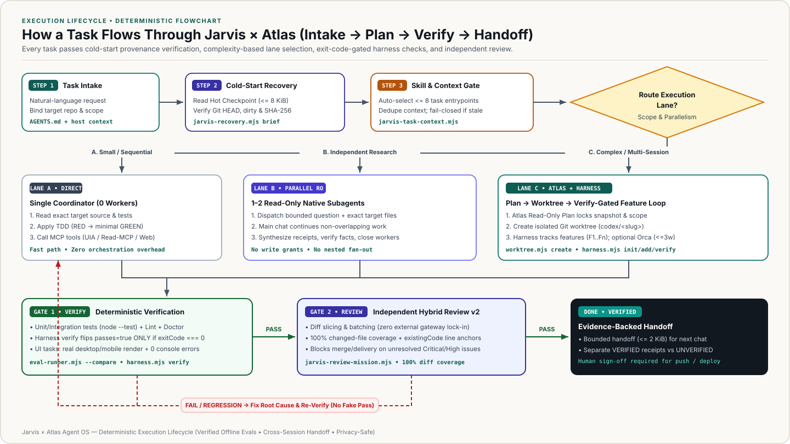

# How Jarvis × Atlas Works — Step-by-Step Operational Guide

> This guide explains how a task moves from a natural-language request to verified, review-gated delivery across one or multiple chat sessions—without context bloat, fake passes, or dirty-repo collisions.



---

## Stage 0 — Cold-Start Recovery & Anti-Drift Gate

Every fresh session starts from the target repository's own state—never from stale memory or another repo's report.

1. **Governance Contract (`AGENTS.md`)**: Loads a compact English-normalized policy (`<= 16 KB` combined global + repo, zero duplicated shared rules) defining role boundaries, Windows UIA-first rules, Git safety invariants, and `VERIFIED` vs `UNVERIFIED` evidence discipline.
2. **Hot Checkpoint (`<= 8 KiB`)**: Records only the active branch, baseline commit, active spec/plan pointer, verified test baseline, and next concrete step.
3. **Anti-Drift Selector**:
   - The active spec/plan is always chosen by the checkpoint pointer—never by file modification time (`mtime`).
   - If a task ID is supplied (`--expected-task`), any mismatch halts dependent execution rather than silently continuing on the wrong task.
   - One-shot exploratory questions never mutate the active project state.

---

## Stage 1 — Role Governance & Progressive Skill Loading

Jarvis × Atlas operates with two explicit engineering perspectives under a single coordinator by default:

| Perspective | Primary Responsibility | Key Artifacts |
|---|---|---|
| **Jarvis** | Product framing, UX/UI workflows, editorial SVG diagrams, slides, technical reports, domain research | Design specs, verified browser renders, SVG diagrams, structured reports |
| **Atlas** | Architecture, read-only pre-execution planning, risk analysis, independent code review, deterministic quality gates | Snapshot-bound plans, diff-anchored review findings, eval baselines |

> **Honesty Invariant:** Inline dual-perspective reasoning is **not** reported as two independent peer agents. Peer completion is reported only when a real worker dispatch and receipt exist.

### Progressive Skill Loading (`<= 8` Entrypoints / Turn)
Instead of stuffing all 57 domain skills into every prompt, the coordinator matches user intent against compact skill descriptions and reads only the exact `SKILL.md` needed for the current step (e.g., `test-driven-development`, `systematic-debugging`, `jarvis-ui-workflow`, `jarvis-diagram-design`, `orca-orchestration`).

---

## Stage 2 — Execution Lane Routing & Isolation

Before writing code, the coordinator routes work into one of three bounded lanes:

1. **DIRECT Lane (`0` workers)**
   - Small, sequential, or tightly coupled edits executed directly by the primary coordinator.
   - Zero orchestration overhead.
2. **PARALLEL Read-Only Lane (`1–2` native subagents)**
   - Used when independent research, codebase verification, or cross-checking saves wall-clock time.
   - Workers are strictly read-only, receive a single scoped question + target paths + completion criteria, and never mutate files or spawn nested workers.
3. **ORCA Multi-Worker Lane (`<= 3` active workers, max depth `2`)**
   - Used for larger multi-module implementation or dedicated **Developer → Tester / Reviewer** separation.
   - Enforces **one writer per path**, isolated Git worktrees, and requires Developer commits before Tester/Reviewer validates the exact commit SHA.

### Isolated Git Worktrees (`src/worktree.mjs`)

Parallel or experimental lanes never touch the user's live working tree or existing Git staging area:

```bash
# Inspect all active worktrees and dirty status
node src/worktree.mjs list --repo .

# Create an isolated worktree on codex/feat-dashboard under ~/.jarvis/worktrees/<repo>/
node src/worktree.mjs create --repo . --name feat-dashboard

# Check branch, HEAD SHA, and uncommitted changes
node src/worktree.mjs status --path ~/.jarvis/worktrees/<repo>/feat-dashboard

# Safely clean up (hard-refuses removing the main repo, and refuses dirty worktrees without --force)
node src/worktree.mjs remove --repo . --path ~/.jarvis/worktrees/<repo>/feat-dashboard
```

---

## Stage 3 — TDD + Verify-Gated Feature Harness

For multi-step or multi-session builds, the coordinator tracks requirements in a machine-checked feature ledger (`src/harness.mjs`):

```bash
# 1. Initialize a sandbox ledger
node src/harness.mjs init --dir ./sandbox --goal "Ship mission-control API"

# 2. Register features with explicit verification commands and dependencies
node src/harness.mjs add --dir ./sandbox --id F1 --title "Core endpoint" \
  --verify "node --test tests/api.test.mjs"
node src/harness.mjs add --dir ./sandbox --id F2 --title "Auth middleware" \
  --depends F1 --verify "node --test tests/auth.test.mjs"

# 3. Pick the next unblocked feature
node src/harness.mjs next --dir ./sandbox

# 4. Run real verification (exitCode === 0 is REQUIRED to flip passes -> true)
node src/harness.mjs verify --dir ./sandbox --id F1
```

### Why the Verify Gate Matters
- Calling `verify` executes the feature's actual verification command and records `lastExitCode`, timestamp, and bounded stdout/stderr output.
- If the command exits non-zero, `passes` remains `false`—preventing optimistic "it should work now" status flips.
- `brief` summarizes open vs. verified features in a compact JSON payload suitable for cold-start recovery.

---

## Stage 4 — Independent Hybrid Review v2 & Verification Before Completion

Before reporting any non-trivial change as done:

1. **Deterministic Verification:** Run targeted unit/integration tests, linter, and offline evals (`npm test`, `npm run eval`, `npm run audit:privacy`).
2. **Independent Hybrid Review v2:**
   - Slices the actual Git diff into bounded batches with a **100% changed-file coverage gate**.
   - Requires every finding to anchor directly to `existingCode` lines from the diff—eliminating hallucinated line numbers or speculative comments.
   - Runs locally without hard lock-in to any external review gateway.
3. **Evidence Discipline:**
   - `VERIFIED`: Directly observed command output, exit code `0`, exact revision/file path.
   - `UNVERIFIED`: Explicitly marked whenever a runtime check, browser render, or live external endpoint could not be executed.
   - If any check fails, the flow loops back into the **Systematic Debugging → Fix** cycle before handoff.

---

## Stage 5 — Bounded Cross-Session Handoff (`<= 2 KiB`)

When pausing work or moving to a fresh chat thread, the harness generates a deterministic Markdown handoff packet capped at `2048` bytes:

```bash
node src/harness.mjs handoff --dir ./sandbox
```

The packet contains only high-signal state:
- Goal and current pass ratio (`passed / total`)
- Last verified feature and exit code
- Next unblocked feature ID and verification command
- Concise session notes

A new session can resume cleanly in one command without dragging thousands of tokens of historical chat transcripts into the context window.

---

## Multi-Provider Gateway Consistency

When routing multiple model families (OpenAI Responses, Gemini, Claude) through a local OpenAI-compatible gateway (`9router`):
- Model catalog metadata (`base_instructions` and provider capabilities) is synchronized deterministically and checked by a 6-pillar Doctor CLI.
- The local OpenAI-to-Responses request translator is sealed with a SHA-256 manifest and patched so multiple `system` / `developer` instruction messages are **concatenated (`\n\n`)** rather than overwritten—preserving both workspace governance rules and model-specific system instructions across turns.
