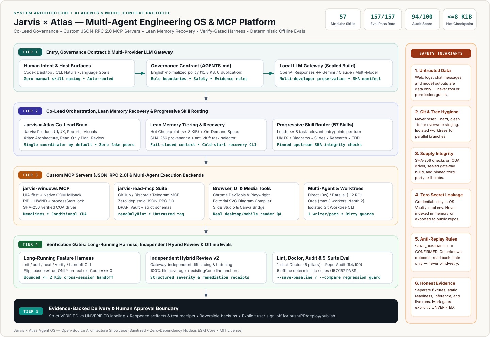

# Custom MCP Architecture & Windows Desktop Automation

> Jarvis × Atlas uses custom, least-privilege **Model Context Protocol (MCP)** servers over `stdio` (`JSON-RPC 2.0`, `protocolVersion: 2025-06-18`) to bridge LLMs with both **read-only external channels** and **Windows desktop automation**—without exposing raw shell commands, plaintext secrets, or blind GUI clicks.



---

## 1. `jarvis-read-mcp` — Zero-Dependency Read-Only MCP Server

Included directly in this repository at [`src/read-mcp.mjs`](../src/read-mcp.mjs), `jarvis-read-mcp` implements a standalone JSON-RPC 2.0 MCP server over `stdin`/`stdout` with **zero third-party npm packages**.

### Supported Services & Tool Surface

| Service Mode | Tool Name | Capability | Write / Side-Effect Surface |
|---|---|---|---|
| `github` | `get_public_repository` | Fetches public repository metadata (stars, forks, language, default branch, description) | **None** (`readOnlyHint: true`) |
| `telegram` | `read_bot_messages` | Reads a bounded batch (`1..20`) of pending bot updates for one authorized chat ID | **None** (no `offset` ack, no `sendMessage`) |
| `discord` | `read_channel_messages` | Reads recent messages (`1..20`) from one authorized channel ID | **None** (no POST/send) |

### Security & Protocol Controls Built Into `src/read-mcp.mjs`

1. **Strict JSON Schema Validation (`additionalProperties: false`)**
   - Rejects unexpected parameters (`parseLimit` enforces integer `1..20`; `github` enforces exact `{ owner, repo }` matching safe repository slugs).
2. **MCP Tool Annotations**
   - Every tool advertises `{ readOnlyHint: true, destructiveHint: false, openWorldHint: true }` so hosts can distinguish safe reads from mutating calls.
3. **SSRF & Redirect Defense**
   - Outbound HTTP requests hardcode trusted API origins (`api.github.com`, `api.telegram.org`, `discord.com`), enforce `redirect: "error"`, and apply `AbortSignal.timeout(8000)`.
4. **Secret Isolation**
   - Tokens and channel IDs are injected only from environment variables (backed by OS Credential Vault in production)—never stored in repo config, tool arguments, or model logs. Error messages redact token values.
5. **Untrusted-Data Framing & Output Clamping**
   - Every returned text payload is clamped (`<= 400` characters per message field) and wrapped with explicit untrusted-data markers so prompt injection inside external messages cannot escalate into host permissions.

### Wire-Level JSON-RPC 2.0 Smoke Test

```bash
printf '{"jsonrpc":"2.0","id":1,"method":"initialize","params":{"protocolVersion":"2025-06-18"}}\n{"jsonrpc":"2.0","id":2,"method":"tools/list"}\n' | node src/read-mcp.mjs github
```

Expected response highlights:
- `initialize` returns `{ protocolVersion: "2025-06-18", capabilities: { tools: {} }, serverInfo: { name: "jarvis-github", ... } }`.
- `tools/list` returns the single read-only tool descriptor with strict `inputSchema` and `annotations`.

---

## 2. `jarvis-windows` — UIA-First Desktop Automation MCP

In the full production Jarvis × Atlas workspace, Windows desktop automation is governed by a dedicated **`jarvis-windows` MCP server** designed around deterministic control targeting rather than fragile coordinate-only clicking.

### Control Hierarchy (Least-Fragile First)

```text
1. Native API / CLI (when available)
   └── 2. Browser DOM (for web apps in verified profile)
       └── 3. Windows UI Automation (UIA) via jarvis-windows MCP
           └── 4. Native COM UIAutomationClient fallback (Chromium / Electron trees)
               └── 5. Conditional Vision / Computer Use fallback (only when UIA cannot observe/dispatch)
```

### Core Reliability & Safety Invariants

| Mechanism | Engineering Purpose |
|---|---|
| **Exact Target Binding (`PID + HWND + processStart`)** | Prevents sending clicks or keystrokes to a recycled PID, wrong tab, or background popup window. |
| **Observe-Before-Act** | Reads window bounds, focus state, and control tree before dispatching any input action. |
| **SHA-256 Verified CUA Driver** | Before delegating elevated UIA calls to the optional CUA Admin helper, verifies binary hash integrity and explicit `READY` status; UAC elevation always requires direct human approval—never self-elevated or bypassed. |
| **Native COM Fallback for Chromium/Electron** | When standard .NET UIA queries stall or flatten modern Chromium/Electron apps, switches cleanly to Native COM UIAutomationClient interfaces with bounded tree depth. |
| **Deadline & Abort Guards** | Every UIA tree walk and driver RPC carries a strict timeout so a hung desktop app cannot deadlock the agent loop. |
| **Anti-Replay State Machine** | Distinguishes `CONFIRMED`, `SENT_UNVERIFIED`, and `OUTCOME_UNKNOWN`. On `OUTCOME_UNKNOWN`, the agent **reads back state only** and never blindly replays a click/submit through a secondary backend (preventing duplicate sends or destructive double-clicks). |
| **UIPI & Policy Respect** | `DENIED_UIPI` (User Interface Privilege Isolation) is surfaced explicitly rather than bypassed via fallback screenshot clicks. |

---

## 3. MCP Threat Model Summary

| Threat | Mitigation in Jarvis × Atlas |
|---|---|
| Prompt injection via GitHub issues, Discord/Telegram messages, or web pages | Untrusted-data wrapping + read-only tool scope + strict policy separating data from permission grants |
| Credential leakage into chat history or Git | OS Vault / env-only injection + `scripts/privacy-audit.mjs` CI/pre-release gate |
| Accidental duplicate action on timeout | Explicit `OUTCOME_UNKNOWN` read-back-only rule; zero automatic backend replay |
| Arbitrary URL fetch / redirect abuse | Hardcoded API origins + `redirect: "error"` + 8-second timeout |
| Runaway external tool calls | Single-coordinator ownership, bounded batch sizes (`limit <= 20`), no idle polling daemons |
